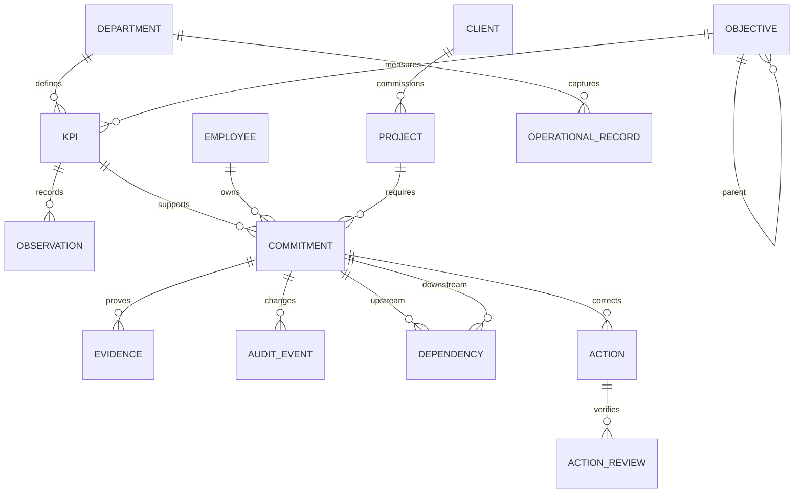

# CMIH enterprise performance and accountability blueprint

20 October 2026. Scope: Staff Portal. This document covers all 45 requested blueprint outputs. Implementation status is recorded separately in PERFORMANCE-REQUIREMENT-COVERAGE.md; a designed feature is not automatically a delivered feature. No production migration or deployment is implied.

## 1. Executive summary

Make the portal the operating record of commitments, results and management intervention. Use six departments: Brands, Client Relations, Operations / Projects, Creatives, Finance and HR / Admin. HR / Admin contains separate HR and Admin / Administrator tables. Preserve one common accountability framework while allowing genuinely different departmental records and metrics.

## 2. Business problem statement

Narrative reports obscure expected outcomes, duplicate figures, hide unresolved dependencies and make performance difficult to trace. Generic weekly columns cannot represent a creative brief, an invoice and a recruitment vacancy accurately. A reported completion is not proof of delivery; missing data is not zero performance.

## 3. Business objectives

Give management evidence-backed answers about delivery, ownership, timeliness, quality, financial exposure, client satisfaction, capacity and corrective action. Reduce manual consolidation, reconcile source totals and make every summary traceable to records. Baseline adoption and reporting effort before claiming improvement.

## 4. Accountability philosophy

Target → commitment → owner → deliverable → deadline → actual → variance → evidence → status → action → escalation → decision. Activities are effort; deliverables are outputs; outcomes are business effects; KPIs measure results; milestones are dated checkpoints. Issues exist now; risks are uncertain future events. Financial impact is a separately substantiated amount, never inferred from a red status.

## 5. Target operating model

Staff accept assignments and maintain results/evidence. Reviewers independently assess outputs. Department heads approve targets and own unresolved exceptions. Finance reconciles financial sources; HR controls personnel records. Executives decide cross-functional trade-offs. Weekly meetings review exceptions and actions; monthly meetings assess results and capacity; quarterly meetings review objectives and strategy.

## 6. Enterprise performance architecture

Eleven layers: enterprise objectives; departmental objectives; KPI definitions; period/entity targets; deliverables; accountable ownership; workflow; versioned evidence; measurement; escalation; executive intelligence. Objectives can have parents. Observations retain their KPI, owner, entity scope, period and source. Commitments link to the measurement definition without duplicating the department's revenue on every task.

## 7. Functional KPI framework

| Department | Operational record and distinct table headings | Required measurement families |
|---|---|---|
| Brands | Brand, campaign, channel, asset, publication date, planned/delivered assets, reach, interactions, leads, owner, next action | Content delivery/compliance, engagement, campaign spend, audience outcomes |
| Client Relations | Client, project, owner, stage, probability, proposed/PO/invoiced/collected amounts, target, actual, bottleneck, next action, due date | Revenue/growth/new business/retention/cross-sell; satisfaction/complaints/issues/resolution/meetings/engagement; proposals expected/submitted/won/conversion/value/pipeline; collections target/actual/receivables/ageing/efficiency |
| Operations / Projects | Project, milestone, accountable owner, baseline/due/actual dates, dependency, budget, actual cost, forecast completion cost, risk, action | Awarded/initiated/completed projects; milestones/on-time delivery; revenue/GP/margin/budget variance; rework/complaints/quality; risk/dependency/escalation |
| Creatives | Brief, client, designer, acceptance, concept/review stage, revisions, final output, planned/actual hours, deadline, approval/quality | Received/accepted/developing briefs; concept submitted/approved; artwork/jobs; turnaround/on-time/first approval/revision/quality; workload/capacity/bottlenecks |
| Finance | Client/invoice/supplier/reference, issue/due date, lifecycle, value, receipts/payments, outstanding balance, age band, owner | Revenue target/actual/variance by entity; receivables/current/overdue/collections; payables/due/ageing/exposure; inflow/outflow/net/forecast; GP/margin/contribution/cost variance; invoice lifecycle |
| HR / Admin: HR | Period, recruitment position/count; personnel movement/staff/count; attendance/leave; training title/delivery/completions/denominator; appraisal dates; compensation; relations; current/previous/variance; priorities/owner/due | Headcount/vacancies/attrition/hires; attendance/absence/lateness/leave; reviews/objectives/KPIs/PIPs; candidates/interviews/offers/time-to-fill; grievances/discipline/resolutions |
| HR / Admin: Admin / Administrator | Office area/status/issue/action/owner/due; fleet current/previous/notes; drivers current/previous/notes; asset status/notes; next-period priorities | Availability/utilization/downtime/maintenance; litres/cost/efficiency/variance; trips/deliveries/requests/completion/delays; assets/allocations/condition/missing/damaged; facilities resolution |

No current targets or historical example figures are invented. The supplied HR workbook and Admin report define capture structure. The CR workbook is a source requiring a dated, owner-mapped migration; it has not been silently imported.

## 8. KPI dictionary structure

Each definition needs stable ID/version, name, enterprise/department objective, exact definition/formula, unit, direction, aggregation, source/reference, frequency, owner, independent reviewer, effective dates, period/entity target, green/amber thresholds, red rule, required action and evidence policy. Identical shared KPIs use one canonical definition. Changes require new versions and preserve historic calculations. Do not execute user-entered formulas as code.

## 9. Deliverable management architecture

Record ID, department, output/type, objective, linked KPI, owner, support team, client/project, baseline start/due date, completion timestamp, progress, target/actual, quality, evidence, priority, risk, issue/impact, cause, corrective action, action owner/due date, escalation and decision. Supporting contributors do not receive duplicate ownership credit. Any link to an existing task must prevent double counting.

## 10. Workflow architecture

Create/assign → accept → execute → review → complete → verify → close. Owner supplies evidence and result; reviewer can return with notes. Verification requires independent reviewer and quality assessment. A reopened record retains prior history. Locked revisions prevent lost updates. Historical Done records stay legacy until reviewed; do not manufacture verification dates.

## 11. Cross-functional dependency model

Directed upstream/downstream edges link commitments, responsible departments/owners, dates and impact. Reject cycles and self-links. Example: brief → concept → client approval → production → delivery → invoice → collection. Show blocked work, upstream lateness and downstream exposure. A dependency is not permission to inspect confidential upstream financial or HR payloads.

## 12. Exception and escalation framework

Rules cover overdue commitments, missed KPIs, budget tolerance, overdue invoices, complaint SLA, vacancy age, maintenance dates, delayed milestones and repeat failures. Retain evaluated time, rule version, source and recipient. Amber requires action; red escalates immediately to the function head; unresolved exceptions escalate after the configured period. Exact financial tolerances and SLAs must be policy values, not guessed targets.

## 13. Accountability framework

Keep eight traceable dimensions: target achievement, timeliness, quality, financial performance, stakeholder performance, issue resolution, compliance and process discipline. Function-specific KPI weights explain these dimensions. Separately, the confirmed staff/team formula is 10% system attendance + 65% manager-verified completion + 25% department-specific KPI achievement. Missing components leave an incomplete score with a measured subtotal; never redistribute their weights. Pool team denominators rather than summing staff percentages. Do not present a generic league table of incomparable departments.

## 14. Data architecture

Transactional masters: departments/functions, employees/roles/teams, clients, projects, objectives, versioned KPIs, dates/statuses/priorities/cost centres. Transactions: commitments, observations, operational registers, dependencies, evidence, audit events, reports, actions and notifications. Reporting dimensions must use stable keys. Snapshot balances are distinct from period flows; source periods and event dates are separate.

## 15. Data model / ERD concept

BI mapping: Dim_Function/Department→department catalogue; Dim_Employee→users with effective team assignment; Dim_Client/Project→canonical CRM/project IDs; Dim_KPI→versioned definition; Dim_Date→calendar; Dim_Status/Priority→controlled vocabularies; Dim_Cost_Center→approved cost-centre master. Fact_Deliverables→commitments; Fact_KPI_Performance→approved observations; Fact_Project_Performance→project/milestone records; Fact_Revenue/Collections/Expenses→reconciled finance sources; Fact_Attendance→approved attendance/leave; Fact_Requests/Issues/Actions→operational and corrective-action records; Fact_Fleet/Assets→Admin registers. These BI views are a target design, not deployed Fabric tables.

## 16. Data collection architecture

Department forms answer what/why/who/when/target/actual/status/evidence/issue/action/impact with typed fields. Use selectors and existing master data. Prioritise source adapters over re-entry. Imports need source system+reference uniqueness, dry run, owner/date mapping, rejection log and reconciliation totals before approval. Historical spreadsheets are retained as provenance.

## 17. Technology architecture

Keep the existing Laravel application, relational database, private evidence storage and scheduled jobs. Use an outbox to separate transactional changes from delivery. Existing authenticated routes enforce the same scope on screens, downloads and exports. Add read-only reporting views before external BI. Production sizing, retention, backup and queue capacity require measured user/data volume.

## 18. Power BI dashboard architecture

Optional semantic model over approved facts and conformed dimensions. Pages: enterprise, function, accountability, KPI, exceptions, trends, dependencies and meeting mode. Include row-level department/team permissions and separate financial/HR entitlements; never rely on hidden visuals. Measures aggregate rates by numerator/denominator and balances by latest entity snapshot. Show refresh time and coverage. Fabric is deferred until integration/history volume justifies licensing and maintenance. No Microsoft tenant connection is presently claimed.

## 19. Executive dashboard wireframe

Period / scope / freshness → commitments due, verified, overdue, at risk → function comparison (achievement, delivery, on-time, exceptions) → authorized revenue/GP/receivables/cash → satisfaction/risks → decisions required. Every card opens its underlying scoped records. Missing sources show unavailable with a coverage explanation.

## 20. Standard functional dashboard wireframe

Department / reporting period → objective/KPI results → department-specific operational table → delivery tracker → exceptions/action owners → staff/team capacity and 10/65/25 breakdown → comparable-period trends. HR / Admin has an obvious HR | Admin / Administrator switch. CR private amounts have a separate staff-wide percentage projection.

## 21. Deliverable tracker wireframe

Filters: function, team, owner, client, project, KPI, priority, state, due date, month/quarter and overdue. Summary counts sit above the table. Main columns: output, accountable owner, deadline, state/progress, achievement, issue/action. Expand for baseline, evidence, quality, dependencies and history. Mobile uses labelled stacked detail and contained table scrolling.

## 22. KPI dashboard wireframe

KPI/definition/objective → target | actual | achievement | variance | previous | YTD | RAG | owner → trend → source results and evidence → related deliverables/actions. Display unit and method next to values; percentage-point variance is distinct from percentage growth. Data freshness and approval coverage stay visible.

## 23. Exception dashboard wireframe

Severity / type / owner / age filters → critical and amber counts → exception table with rule, source, impact, accountable owner, action, deadline, escalation and decision. Resolve the underlying cause; dismissing an alert does not complete work. Restrict financial exposure fields to entitled users.

## 24. Management meeting dashboard

Live agenda: what was committed; delivered; missed; recorded cause; impact; action owner; resolution date; required decision. Capture decision/action and next review date in the same record. Weekly focuses on intervention; monthly on KPI/financial/client performance; quarterly on strategic objectives, trends and initiatives. Printable/exportable reports require the same access scope.

## 25. Role-based access architecture

Individuals: own commitments/KPIs/actions/feedback. Team leads: assigned team workload and reviews. Heads: own function. CVO and Super Admin: every portal module, including private CR, HR, Finance, warehouse and printing. This supersedes the earlier CR-members-only interpretation under the user's explicit executive-access instruction. Other roles retain function and individual scope. The shared weekly CR projection still contains percentages and safe labels only. HR discipline/compensation sections require full HR entitlement. Apply server checks to HTML/JSON/files/exports/notifications. Team-specific hierarchy refinement remains an acceptance item.

## 26. Automation architecture

Scheduled evaluators process deadlines, KPI thresholds and reporting periods. Write deduplicated outbox entries, then deliver asynchronously with retry limits and failure logs. Workflow assignment/review events create immediate alerts. Extend typed departmental rules for invoice ageing, budgets, recruitment and maintenance. Automated weekly/monthly/quarterly packs must eventually freeze approved source IDs and definition versions; current live report links are not immutable period snapshots.

## 27. Notification architecture

Dashboard notifications are the baseline. Email requires configured transport and enabled delivery. Teams requires tenant application/webhook authorization; mobile push requires a registered client and consent. Channel payloads contain minimal text and authenticated scoped links, never confidential amounts in a public channel. Track queued/sent/failed separately. Avoid duplicate recipient/event notifications and stale reminders after resolution.

## 28. AI and analytics opportunities

Comparable-period KPI trends, completion trends, issue recurrence, capacity and dependency analysis precede prediction. The local simple trend projection requires six consecutive measured months and is labelled extrapolation. AI summaries may cite approved facts and suggest questions; they must not invent causes, targets or personnel judgments. Validate prediction error, bias and intervention usefulness before relying on it.

## 29. Data governance framework

Heads are data owners; named departmental stewards maintain master data and quality; KPI owners maintain definitions; staff enter evidence; independent reviewers approve. Required controls: valid IDs/dates/units, immutable events, baseline revisions, duplicate/overlap checks, mandatory owners/evidence, explicit unmeasured states, source reconciliation and least privilege. Retention/deletion and backup restoration need approved policies and operational rehearsal.

## 30. KPI calculation methodology

Higher achievement = actual/target×100. Lower achievement uses a disclosed linear distance index max(0,(1+(target−actual)/abs(target))×100); it is not reciprocal efficiency. Target zero yields unmeasured achievement, not division by zero. Variance=actual−target; direction determines favourability. Completion=verified assigned outputs/all assigned outputs. On-time=dated verified completions by deadline/all dated verified completions, with date coverage. Overdue=unfinished past deadline. Productivity=verified outputs/eligible hours (do not compare unlike work). Quality=reviewer rubric score with sample count. Cost/budget variance=actual−approved baseline. Revenue/GP variance=actual−target; GP=revenue−attributable cost; margin=GP/revenue. Collection efficiency=receipts/collectible invoice base; issue resolution=resolved/eligible issues; SLA=eligible resolved within SLA/eligible resolved. Rates retain both operands. Trend compares consistent periods/definitions. Weighting caps staff component achievement at 100 while retaining raw KPI overachievement. No denominator means unmeasured.

## 31. Business rules

Independent submitter/owner/reviewer controls apply to approval. Submitted/approved reports cannot be edited through draft paths. Baseline changes need reason and version. Open blocked work remains overdue. Cyclic dependencies are invalid. Actual zero is valid; missing values remain missing. Finance quantities require source period/currency and no duplicate entity totals. Sensitive fields cannot enter the public CR projection. A named exception rule, not user-selected colour, determines RAG.

## 32. User journeys

Staff: assignment notification → accept → progress/evidence → submit → correction or verified result. Head: create objective/KPI/target → assign → review evidence → verify → resolve exceptions. Executive: scope enterprise → drill to underperformance → inspect cause/evidence → record decision and action owner. HR/Admin: select internal report → capture matching section headings → compare prior approved period → independent review. CR: maintain private pipeline → publish safe progress percentages → reconcile invoice/PO/client records.

## 33. Functional requirements

Capture every accountability field; department-specific reporting; independent workflow; KPI dictionary/period observations; evidence versions; dependency graph; configurable exceptions; source-backed drilldown; root-cause/action management; role filters; staff/team scoring; weekly/monthly/quarterly reporting; PDF/Excel; audit history; migration reconciliation. See the coverage matrix for implementation gaps, not implied completion.

## 34. Non-functional requirements

Responsive layouts and keyboard/label accessibility; colour-independent status; indexed/paginated reads; bounded exports and queued large work; timezone-consistent dates; concurrency protection; private files; authenticated exports; auditable data changes; recoverable migrations; backup/restore exercise; delivery/queue monitoring. Establish p95 response, uptime and RPO/RTO targets from production baseline and business policy. Do not invent an SLA unsupported by infrastructure.

## 35. Integration requirements

Accounting: approved invoices, credit notes, receipts, expenses and balances. CRM: canonical clients/proposals/pipeline. HR: employment dates, attendance, approved leave and payroll permissions. Project/creative: briefs, reviews, milestones, cost and capacity. ERP: master data/cost centres. Email/Teams: delivery receipts and minimal scoped payloads. SharePoint/Drive: access-controlled evidence. Power BI/Fabric: read-only approved facts. Each adapter requires credentials, source contract, idempotent IDs, reconciliation, retries, freshness and error ownership; none is considered connected merely because designed.

## 36. Implementation roadmap

1 Discovery: sources, interviews, maps, pain points. 2 Framework: objectives, dictionary, targets, owners. 3 Architecture: master/transaction model, governance, integrations. 4 MVP: tracker, KPIs, executive/function/exception views. 5 Workflow: review, evidence, notifications, escalation and corrective actions. 6 Analytics: comparable trends, root causes, evaluated prediction and summaries. 7 Scale: remaining functions/sources and monitoring. Existing code spans these phases but production acceptance remains gated by the coverage matrix.

## 37. MVP definition

Six functional entry points; two HR/Admin tables; private CR plus safe shared projection; agreed 10/65/25 scoring with missing-data transparency; verified commitments/evidence; approved KPI results; exceptions; traceable exports. Release requires department walkthroughs, representative data reconciliation, privacy checks, responsive QA, migration rehearsal and a deployment/rollback plan. Passing unit tests alone is insufficient.

## 38. Future-state roadmap

Versioned KPI policy editor, independent corrective-action closure, department-safe shared tables, immutable scheduled packs, real source adapters, canonical client/project masters, team hierarchy, BI semantic model, richer evaluated analytics. Maintain parity between live views and exports; retire duplicate legacy entry only after reconciliation.

## 39. Risks and mitigation

Self-report inflation→independent review. Duplicate tasks/ledgers→source links and reconciliation. Incorrect targets→approved baselines. Hidden missing data→coverage labels. Private disclosure→separate safe projections and tests. Scoring unfairness→denominators, work context and appeal history. Imported history errors→dry run and source retention. Alert fatigue→dedupe and actionable rules. Migration failure→backup and rollback rehearsal.

## 40. Change-management plan

Preview the new departmental experience with heads; demonstrate actual tasks rather than announce cosmetic changes. Pilot with representative staff, document old→new field mapping, preserve history and run parallel reconciliation. Publish scoring examples and correction procedures. Collect feedback before retiring legacy tables. Announce only features that have passed acceptance.

## 41. Training requirements

Staff: outputs versus activities, acceptance, evidence, updates and corrections. Reviewers: quality rubric, independent approval and returns. Heads: targets, denominators, thresholds, capacity and intervention. Executives: scope, drilldown, coverage and decisions. Stewards: imports, reconciliation, sensitive access and audit. Provide short role-specific walkthroughs and an accessible help route.

## 42. Governance model

Sponsor approves objectives and release scope; heads approve function definitions; Finance owns accounting reconciliation; HR owns personnel access; technology owner maintains reliability/security; product owner maintains coverage and acceptance. Changes to scoring/KPIs are dated, reviewed and communicated. Preserve locked historical awards; the local new formula effective date of 1 October 2026 is an assumption requiring policy confirmation before release.

## 43. Recommended technology stack

Laravel + current SQL database + Blade/Tailwind + private object/file storage + scheduler/queue/outbox. Add reporting SQL views and optional Power BI after source reconciliation. Choose Power Apps/Dataverse/Power Automate only if mobile/process integrations and tenant licensing justify another platform; Fabric only with demonstrated scale. Existing deployment assets and team maintenance capability favour improving the current portal.

## 44. Estimated implementation workstreams

Business/process and KPI governance; database/migration/reconciliation; department workflow/backend; dashboard/mobile UX; access/audit; integration/notifications; analytics/exports; QA/operations; training/adoption. Estimate each against remaining coverage items and available people after discovery. Critical path: approved definitions → trusted source data → scoped calculations → user acceptance → production migration. A calendar/budget estimate without these inputs would be unreliable.

## 45. Success measures

Track owner/target/evidence completeness; independent review coverage; source reconciliation variance; update freshness; on-time/overdue trend; corrective-action closure time; exception recurrence; notification failures; report preparation time; active usage by department; management drilldown success; export/access defects. Record denominators and baseline dates. Business improvement claims require evidence beyond a newly launched dashboard.
